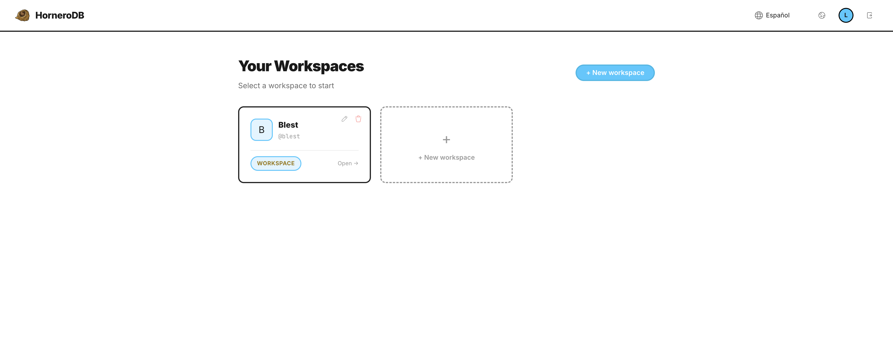

# 🐦 HorneroDB

[English](#english) | [Español](#español)

---

<a name="english"></a>
## English Version

### Wanna vibecode an e-commerce, or build it by hand?
But... What about the website's data? The actual database? Permissions and access control?

Your *vibecoded* app can get **production-grade security controls** — fine-grained permissions, SSO and API keys — without paying for an "Enterprise" plan. That's what **HorneroDB** is for.

**Built with Go + React (Optional).** A CRM / database in the style of Airtable, NocoDB, or PocketBase, but with an absolute focus on security: SSO using OIDC, and table, column, and row-level permissions (Dataverse style).



---

## ✨ Why use HorneroDB

HorneroDB is a **security-first, self-hosted** PostgreSQL backend: a REST API, an MCP server and reliable webhooks, with Dataverse-style permissions on top of plain PostgreSQL.

* **BYOIdP & API Key Security** — Modern authentication (SSO/OIDC for humans, API Keys for programmatic access) with your own identity provider. Your security shouldn't be locked behind an "Enterprise" plan. *OIDC is implemented and tested with [Pocket ID](https://pocket-id.org); Entra ID and Keycloak connectors are on the v1.1 roadmap. Passkeys/WebAuthn are **not** implemented yet — use your IdP's passkey support in the meantime.*
* **PostgreSQL at its core** — Rich data types and the flexibility of a professional relational database.
* **Granular Permissions (APIs and Staff)** — Strict control for your APIs (for your public frontend or *customer-facing* AI agents) and for your users (business staff).
  * *Column-level security per operation* (control who reads, creates, updates, or deletes each field).
  * *Row-level security by owner* — in v1.0 the `own` level filters rows by `created_by`. Arbitrary custom conditions (visual rule builder) land in v1.1.
* **Webhooks you can trust** — Transactional outbox, HMAC-signed payloads (`X-Hornero-Signature`) and SSRF protection on delivery.
* **End-to-End OpenTelemetry Observability (Opt-In)** — Native W3C `traceparent` propagation from Web Consumers / Browser RUM (`@openobserve/browser-rum`) through HorneroDB (Go/Gin/GORM), Pocket ID, PostgreSQL 18 and async webhooks, with a turnkey **OpenObserve + OTel Collector** stack in [`deploy/observability/openobserve/`](deploy/observability/openobserve/).
* **Excel-like Experience** — Inline cell editing, full keyboard navigation, and seamless copy/paste support.

> 📋 For the full product vision, architecture diagram, subsystem status matrix, and known v1.0 caveats, see **[`docs/STATUS.md`](docs/STATUS.md)**.

## 🛠️ Developer Tools

We are building an ecosystem designed for the modern developer:

* **✅ Hornero MCP** — Plug HorneroDB into the AI you are *vibecoding* with. The AI will understand your backend, configure your database, and program the UI automatically. **Now with full security**: authentication, workspace isolation, and granular permissions (row/column-level).
* **(Upcoming) Data Security Agent** — A System Prompt for a specialized agent that can help you configure and manage your database security.
* **OpenAPI Collection** — Making it extremely simple to integrate with other platforms (Native support for n8n, PowerAutomate, etc.).
* **Implementation Examples** — Ready-to-use templates (e.g., Booking System, E-commerce).

---

## 💼 Services and Business Model

Designed for small businesses that need to solve their management without complications:

* **Turnkey installation and configuration ($$$)**.
* **You choose where it runs:** On-premise or Cloud. It can be hosted on cloud servers, on a Raspberry Pi, on an old computer running in the back of your shop  or even on a Kubernetes cluster. We accompany your scale.
* **Subscription Plans:** There are no subscription plans, you own your data, your server and your business.

---

## 🚀 Quick Start

### Play with Docker (One-Click Setup)

Test HorneroDB instantly using the Docker Playground:

[](https://labs.play-with-docker.com/?stack=https://raw.githubusercontent.com/lucahttp/HorneroDB/refs/heads/main/docker-compose.yml&stack_name=HorneroDB)

### Prerequisites

* Docker & Docker Compose
* A `.env` file (see `.env.example`)
* *For local development:* Node.js and Go runtimes.

### Deployment (Docker)

```bash
# Clone and prepare the environment
cp .env.example .env

# Start the application
docker-compose up -d
```

Visit `http://localhost:5173` to access the UI.

The Compose stack ships three services (`postgres`, `pocket-id`, `hornerodb-server`) with `restart: unless-stopped` and health checks, and the image runs as a **non-root user** (`hornero`). The bundled PostgreSQL lives on the internal Compose network, so `docker-compose.yml` sets `DB_ALLOW_INSECURE_SSL=true` and `DB_ALLOW_INSECURE_DB=true` by default — **turn both off (and use a real password + TLS) for any internet-facing deployment**.

### Manual Setup (Development)

```bash
# Build and run the Backend
go build -o bin/hornerodb ./cmd/server
./bin/hornerodb

# Run the Frontend
cd web/ui && npm ci && npm run dev
```

### Continuous Integration

Every push to `main` and every pull request runs a single unified CI job (`.github/workflows/ci.yml`): the UI is linted and built with `npm ci` first (the Go binary embeds `web/ui/dist`), then `go vet ./...`, `go test -race ./...` and `go build ./cmd/server`. A second job builds the hardened Docker image (no push).

---

## 🔐 Security in Detail

HorneroDB provides fine-grained security at multiple levels:

### Table-Level Permissions

Access control per role: `all`, `own`, or `none`.

```json
{
  "appointments": {
    "create": "all",
    "read": "all",
    "update": "own",
    "delete": "none"
  }
}
```

### Column-Level Permissions by Operation

Define which columns are visible/editable for each operation (e.g., the public API only reads certain fields, staff sees everything):

```json
{
  "appointments": {
    "columns": {
      "read": ["from", "to", "date"],
      "create": ["customer", "email", "phone", "from", "to", "date"],
      "update": ["status"]
    }
  }
}
```

### Granular System Permissions (Admin & API)

Beyond data, you can control who manages the system itself using the reserved `__system__` namespace. Ideal for limiting "employee" access or creating specialized API Keys for automations (e.g. n8n):

```json
{
  "__system__": {
    "webhooks": "manage",
    "api_keys": "none",
    "roles": "view",
    "mcp": "all"
  }
}
```

Available actions: `webhooks`, `api_keys`, `roles`, `tables`, `settings`, `mcp`.
Levels: `none`, `view`, `manage`, `all`.

### API Key Security

Each API Key can have specific restrictions. Ideal for your public e-commerce:

```json
{
  "name": "Public E-commerce API",
  "rate_limit_per_minute": 60,
  "allowed_origins": ["https://mydomain.com"]
}
```

### MCP (Model Context Protocol) Security

The MCP server now includes full authentication and authorization:

* **Authentication Required**: All MCP tools require valid JWT/API Key authentication
* **Workspace Isolation**: Users can only access workspaces they have permission for
* **Permission Enforcement**: Row-level and column-level security applied to all MCP operations
* **Structured Logging**: All MCP operations are logged with user context (see [Audit Trail](#audit-trail-status) for what is *not* persisted yet)

Example secure MCP usage:
```javascript
// MCP client must authenticate first via OAuth2 flow
// Then all tool calls include user context for permission checks
{
  "tool": "list_records",
  "arguments": {
    "workspace_id": "...",
    "table_slug": "customers"
  }
  // Automatically filtered by user's permissions
}
```

### Webhooks (v1.0 pillar)

Webhooks are a first-class feature of HorneroDB, not a "coming soon" item:

* **Transactional outbox** — events are written to `_hornero_webhook_events` inside the same transaction that mutates the record, so a delivery can never be lost by a crash between commit and HTTP call.
* **At-least-once delivery with exponential backoff** — 15s × attempt, up to 5 attempts.
* **HMAC signature** — every delivery carries `X-Hornero-Delivery: <delivery-id>` and, when the webhook has a `client_state` secret, `X-Hornero-Signature: t=<unix>,v1=<hex>` (HMAC-SHA256 of `"<timestamp>.<raw body>"` keyed with the secret) so the receiver can verify authenticity and deduplicate.
* **Permission-aware payloads** — the payload is filtered with the *creator's* read permissions (row-level and column-level) before it leaves the server.
* **SSRF protection** — notification URLs are validated against private/loopback ranges and redirects are re-checked.

See [`docs/SECURITY.md`](docs/SECURITY.md) for the full contract.

### Audit Trail Status

Being explicit about what exists today:

* **v1.0 GA (shipped)**: persistent, queryable `_hornero_audit_log` table (`GET /api/v1/workspaces/:id/audit` + Settings → Activity tab) capturing API key, role, webhook and recovery QR events, alongside structured JSON `log/slog` logs for auth, permission checks and MCP data calls.
* **Not implemented yet (v1.1)**: PostgreSQL-native Row Level Security and automated audit retention/export policies. v1.0 enforces row ownership in the application layer (`own` / `created_by`); native RLS and custom visual conditions are planned for v1.1.

### Row-Level Security Scope

| Level | Behaviour in v1.0 | Planned for v1.1 |
|---|---|---|
| `all` | Every row of the table | — |
| `own` | Rows whose `created_by` equals the current user | Visual custom conditions (e.g. `status = 'open' AND owner_team = 'X'`) |
| `none` | No rows | — |

### OData Query Support (Dataverse-style Filtering)

HorneroDB natively supports Microsoft OData query options (`$filter`, `$orderby`, `$select`, `$top`, `$skip`, `$expand`):

- **Filtering**: `GET /api/v1/workspaces/{ws}/data/{table}?$filter=comanda_id eq 'c-123' and status eq 'ready'`
- **Functions**: `GET /api/v1/workspaces/{ws}/data/{table}?$filter=contains(name, 'pizza') or startswith(name, 'Emp')`
- **Sorting**: `GET /api/v1/workspaces/{ws}/data/{table}?$orderby=created_at desc, price asc`
- **Selection**: `GET /api/v1/workspaces/{ws}/data/{table}?$select=id,name,price`
- **Security**: Column-Level Security (CLS) strictly whitelists permitted columns prior to SQL execution, preventing blind data inference.

---

## ⚙️ Security Configuration

### CORS (Cross-Origin Resource Sharing)

By default, HorneroDB only allows requests from the Admin URL (same-origin policy). To enable multiple origins:

```bash
# .env file
HORNERO_ADMIN_URL=http://localhost:5173
CORS_ORIGINS=http://localhost:5173,https://api.example.com,https://app.example.com
```

**Note**: Each workspace can define additional `allowed_origins` for their specific API clients.

### JWT Secret (Development vs Production)

**Development**: If `JWT_SECRET` is not set, a random 32-character secret is generated automatically. You'll see a warning in the logs:
```
⚠️  WARNING: Generated random JWT secret for development: xxxx...
    Set JWT_SECRET env var to persist sessions across restarts
```

**Production**: `JWT_SECRET` is **required** and must be:
- At least 32 characters long
- Changed from the default value
- Stored securely (use environment variables, never commit to git)

```bash
# Production - Required
JWT_SECRET=your-super-secret-random-string-min-32-chars

# Development - Optional (auto-generated if not set)
# JWT_SECRET=dev-secret-change-in-production
```

The development secret is generated **once per process** and reused, so restarting the server is the only thing that invalidates your sessions.

### Trusted Proxies

HorneroDB ignores `X-Forwarded-For` / `X-Forwarded-Proto` unless the request comes from a proxy you trust. Declare them explicitly (comma-separated IPs or CIDRs):

```bash
# .env file
TRUSTED_PROXIES=172.16.0.0/12,10.0.0.1
```

Leave it empty when the server is exposed directly — the default is to trust nobody.

### Initial Setup Token

A fresh deployment requires the first administrator to be created through the setup flow. Set a shared token so that only someone holding it can complete that first step:

```bash
# .env file
HORNERO_SETUP_TOKEN=$(openssl rand -base64 32)
```

### Production Fail-Fast

When `HORNERO_ENV=production` (or `ENV`/`NODE_ENV=production`), the server refuses to start with an insecure configuration:

| Check | Requirement | Escape hatch |
|---|---|---|
| `JWT_SECRET` | Set, ≥ 32 chars, not the default value | — |
| `DB_PASSWORD` | Not empty and not `postgres` | `DB_ALLOW_INSECURE_DB=true` |
| `DB_SSLMODE` | Not `disable` | `DB_ALLOW_INSECURE_SSL=true` |

The escape hatches exist for internal/trusted networks (for example the bundled Docker Compose network, where Postgres is not exposed). Never enable them on an internet-facing deployment.

---

## 🆚 Comparison

| Feature | 🐦 HorneroDB | 🟢 Supabase | 🧊 PocketBase | ⚡ NocoDB | 🧩 Airtable |
| --- | --- | --- | --- | --- | --- |
| **Permissions** | **Granular (Row/Col)** | PG RLS | Collection | Table | Base |
| **Security** | **SSO OIDC (BYOIdP)** | Enterprise | Email/Pass | Enterprise | Enterprise |
| **API** | **Auto-Secure** | REST/GQL | SDK | REST/GQL | REST |
| **Self-Host** | **Docker / Local** | Docker | Binary | Docker | ❌ |
| **Cost** | **Free / Open Source** | Free Tier | Free | Free | $$$ |

---

### Supported Data Types

HorneroDB supports rich column data types mapped directly to PostgreSQL:
* **Text / Long Text**: `VARCHAR(255)` / `TEXT`
* **Numeric**: `NUMERIC` (number/financial), `INTEGER` (integers), `DOUBLE PRECISION` (float)
* **Boolean & Dates**: `BOOLEAN`, `DATE`, `TIMESTAMPTZ`
* **Web & Meta**: `VARCHAR(255)` (email), `VARCHAR(500)` (url), `JSONB` (json/attachments)
* **Relations & Selects**: `UUID` / `UUID[]` (relations), `VARCHAR(100)` / `VARCHAR(100)[]` (select choices)
* **Auto-Number / Auto-Sequence (`autonumber`)**: Atomic, thread-safe sequence IDs (`VARCHAR(255)`) with custom formatting (e.g., `PED-001`, `CMD-0042`, or plain numbers `1, 2, 3...`).

---

## 🗺 Roadmap

**Shipped (v1.0 GA)**
* [x] Full REST API (70+ endpoints, complete [`docs/openapi.yaml`](docs/openapi.yaml))
* [x] OIDC Auth (tested with Pocket ID) + `HttpOnly` session cookie + `POST /auth/logout`
* [x] Granular column-level permissions (CLS) + `__system__` permissions (`none`/`view`/`manage`/`all`)
* [x] Row-level security by owner (`own` / `created_by`)
* [x] Auto-number / Auto-increment sequential fields (`autonumber`)
* [x] Server-side filtering, sorting and search (`?filter`, `?order`, `?search`, plus OData `$filter`/`$orderby`/`$select`/`$top`/`$skip`, CLS-safe) + atomic Bulk Create/Delete API
* [x] Persistent audit trail (`_hornero_audit_log` + `GET /audit` + Activity UI)
* [x] API key rate limiting (minute + hour windows) & domain restrictions
* [x] MCP Server for AI Assistants (Streamable HTTP, SSE, stdio, OAuth2 PKCE S256 & strict workspace isolation)
* [x] Webhooks with transactional outbox, HMAC signatures (`X-Hornero-Signature`), SSRF protection, delivery history & retry UI
* [x] End-to-end OpenTelemetry observability (opt-in OTLP traces/metrics, `slog` correlation, GORM SQL spans, Pocket ID propagation, webhook Span Links, runtime-configured OpenObserve Browser RUM, and [`deploy/observability/openobserve/`](deploy/observability/openobserve/) stack)
* [x] Hardened Docker image (non-root, healthcheck, `/ready`), GitHub Actions CI, backup/restore scripts, [`docs/OPERATIONS.md`](docs/OPERATIONS.md) and [`docs/STATUS.md`](docs/STATUS.md)

**v1.1**
* [ ] Entra ID and Keycloak OIDC connectors
* [ ] Custom row-level conditions (visual rule builder) and PostgreSQL-native RLS
* [ ] Distributed Redis rate limiting for multi-replica deployments
* [ ] S3-compatible file/attachment storage and lightweight Realtime (SSE + `LISTEN/NOTIFY`)

---

## 🐦 Fun Fact

The **Hornero** is Argentina's national bird. They are master builders, crafting incredibly strong nests made of mud and twigs that look like small ovens. Just like the bird, **HorneroDB** is built to be a solid, secure, and reliable home for your data.

**Made in Argentina with ❤️**

---

<a name="español"></a>
## Versión en Español

### ¿Querés vibecodear un e-commerce, o construirlo a mano?
Pero... ¿Qué pasa con los datos de la web? ¿La base de datos real? ¿Permisos y control de acceso?

Tu app *vibecodeada* puede obtener **controles de seguridad de nivel producción** — permisos granulares, SSO y API keys — sin pagar un plan "Enterprise". Para eso existe **HorneroDB**.

**Construido con Go + React (Opcional).** Un CRM / base de datos al estilo de Airtable, NocoDB o PocketBase, pero con un enfoque absoluto en la seguridad: SSO usando OIDC, y permisos a nivel de tabla, columna y fila (estilo Dataverse).


---

## ✨ Por qué usar HorneroDB

HorneroDB es un backend **self-hosted y security-first** sobre PostgreSQL: una API REST, un servidor MCP y webhooks confiables, con permisos estilo Dataverse sobre PostgreSQL puro.

* **Seguridad BYOIdP y API Keys** — Autenticación moderna (SSO/OIDC para usuarios humanos, API Keys para accesos programáticos) con tu propio proveedor de identidad. Tu seguridad no debería estar bloqueada detrás de un plan "Enterprise". *OIDC está implementado y probado con [Pocket ID](https://pocket-id.org); los conectores de Entra ID y Keycloak llegan en la v1.1. Passkeys/WebAuthn **todavía no** están implementados: por ahora usá el soporte de passkeys de tu IdP.*
* **PostgreSQL en su núcleo** — Tipos de datos ricos y la flexibilidad de una base de datos relacional profesional.
* **Permisos Granulares (APIs y Staff)** — Control estricto para tus APIs (para tu frontend público o agentes de IA *customer-facing*) y para tus usuarios (personal de la empresa).
  * *Seguridad a nivel de columna por operación* (controlá quién lee, crea, actualiza o elimina cada campo).
  * *Seguridad a nivel de fila por dueño* — en la v1.0 el nivel `own` filtra por `created_by`. Las condiciones personalizadas (constructor visual) llegan en la v1.1.
* **Webhooks en los que podés confiar** — Outbox transaccional, payloads firmados con HMAC (`X-Hornero-Signature`) y protección SSRF en la entrega.
* **Observabilidad OpenTelemetry End-to-End (Opt-In)** — Propagación W3C `traceparent` desde Web Consumers / Browser RUM (`@openobserve/browser-rum`) hasta HorneroDB (Go/Gin/GORM), Pocket ID, PostgreSQL 18 y webhooks asíncronos, con stack listo de **OpenObserve + OTel Collector** en [`deploy/observability/openobserve/`](deploy/observability/openobserve/).
* **Experiencia tipo Excel** — Edición de celdas en línea, navegación completa por teclado y soporte fluido para copiar/pegar.

> 📋 Para ver la visión completa, arquitectura, matriz de estado por subsistema y limitaciones conocidas de la v1.0, consultá **[`docs/STATUS.md`](docs/STATUS.md)**.

## 🛠️ Herramientas para Desarrolladores

Estamos construyendo un ecosistema diseñado para el desarrollador moderno:

* **✅ Hornero MCP** — Conectá HorneroDB a la IA con la que estás *vibecodeando*. La IA entenderá tu backend, configurará tu base de datos y programará la UI automáticamente. **Ahora con seguridad total**: autenticación, aislamiento de workspaces y permisos granulares (nivel fila/columna).
* **(Próximamente) Data Security Agent** — Un System Prompt para un agente especializado que puede ayudarte a configurar y gestionar la seguridad de tu base de datos.
* **Colección OpenAPI** — Haciendo extremadamente simple la integración con otras plataformas (Soporte nativo para n8n, PowerAutomate, etc.).
* **Ejemplos de Implementación** — Plantillas listas para usar (ej.: Sistema de Reservas, E-commerce).

---

## 💼 Servicios y Modelo de Negocio

Diseñado para pequeñas empresas que necesitan resolver su gestión sin complicaciones:

* **Instalación y configuración llave en mano ($$$)**.
* **Vos elegís dónde corre:** On-premise o Cloud. Puede estar alojado en servidores en la nube, en una Raspberry Pi, en una computadora vieja en el fondo de tu local o incluso en un cluster de Kubernetes. Acompañamos tu escala.
* **Planes de Suscripción:** No hay planes de suscripción, sos dueño de tus datos, tu servidor y tu negocio.

---

## 🚀 Inicio Rápido

### Jugar con Docker (Configuración en un Clic)

Probá HorneroDB al instante usando el Docker Playground:

[](https://labs.play-with-docker.com/?stack=https://raw.githubusercontent.com/lucahttp/HorneroDB/refs/heads/main/docker-compose.yml&stack_name=HorneroDB)

### Requisitos Previos

* Docker y Docker Compose
* Un archivo `.env` (ver `.env.example`)
* *Para desarrollo local:* Runtimes de Node.js y Go.

### Despliegue (Docker)

```bash
# Clone y prepare el entorno
cp .env.example .env

# Inicie HorneroDB, PocketID y PostgreSQL
docker-compose up -d
```

Visitá `http://localhost:5173` para acceder a la UI.

El stack de Compose incluye tres servicios (`postgres`, `pocket-id`, `hornerodb-server`) con `restart: unless-stopped` y health checks, y la imagen corre como **usuario no root** (`hornero`). El PostgreSQL incluido vive en la red interna de Compose, por eso `docker-compose.yml` define `DB_ALLOW_INSECURE_SSL=true` y `DB_ALLOW_INSECURE_DB=true` por defecto — **desactivá ambos (y usá una contraseña real + TLS) en cualquier despliegue expuesto a internet**.

### Configuración Manual (Desarrollo)

```bash
# Build y ejecute el Backend
go build -o bin/hornerodb ./cmd/server
./bin/hornerodb

# Ejecute el Frontend
cd web/ui && npm ci && npm run dev
```

### Integración Continua

Cada push a `main` y cada pull request ejecuta un job único de CI (`.github/workflows/ci.yml`): primero la UI se lintea y compila con `npm ci` (el binario Go embebe `web/ui/dist`), después corren `go vet ./...`, `go test -race ./...` y `go build ./cmd/server`. Un segundo job compila la imagen Docker endurecida (sin push).

---

## 🔐 Seguridad en Detalle

HorneroDB ofrece seguridad detallada en múltiples niveles:

### Permisos a Nivel de Tabla

Control de acceso por rol: `all`, `own`, o `none`.

```json
{
  "appointments": {
    "create": "all",
    "read": "all",
    "update": "own",
    "delete": "none"
  }
}
```

### Permisos a Nivel de Columna por Operación

Definí qué columnas son visibles/editables para cada operación (ej.: la API pública solo lee ciertos campos, el staff ve todo):

```json
{
  "appointments": {
    "columns": {
      "read": ["from", "to", "date"],
      "create": ["customer", "email", "phone", "from", "to", "date"],
      "update": ["status"]
    }
  }
}
```

### Permisos de Sistema Granulares (Admin y API)

Más allá de los datos, podés controlar quién gestiona el sistema en sí usando el namespace reservado `__system__`. Ideal para limitar el acceso de "empleados" o crear API Keys especializadas para automatizaciones (ej. n8n):

```json
{
  "__system__": {
    "webhooks": "manage",
    "api_keys": "none",
    "roles": "view",
    "mcp": "all"
  }
}
```

Acciones disponibles: `webhooks`, `api_keys`, `roles`, `tables`, `settings`, `mcp`.
Niveles: `none`, `view`, `manage`, `all`.

### Seguridad de API Keys

Cada API Key puede tener restricciones específicas. Ideal para tu e-commerce público:

```json
{
  "name": "Public E-commerce API",
  "rate_limit_per_minute": 60,
  "allowed_origins": ["https://midominio.com"]
}
```

### Seguridad de MCP (Model Context Protocol)

El servidor MCP ahora incluye autenticación y autorización completas:

* **Autenticación Requerida**: Todas las herramientas MCP requieren autenticación válida mediante JWT/API Key.
* **Aislamiento de Workspaces**: Los usuarios solo pueden acceder a los workspaces para los que tienen permiso.
* **Aplicación de Permisos**: Seguridad a nivel de fila y columna aplicada a todas las operaciones MCP.
* **Logging Estructurado**: Todas las operaciones MCP se registran con el contexto del usuario (mirá [Estado del Audit Trail](#estado-del-audit-trail) para lo que *todavía no* se persiste).

Ejemplo de uso seguro de MCP:
```javascript
// El cliente MCP debe autenticarse primero a través del flujo OAuth2
// Luego, todas las llamadas a herramientas incluyen el contexto del usuario para verificaciones de permisos
{
  "tool": "list_records",
  "arguments": {
    "workspace_id": "...",
    "table_slug": "customers"
  }
  // Filtrado automáticamente por los permisos del usuario
}
```

### Webhooks (pilar de la v1.0)

Los webhooks son una funcionalidad de primera clase de HorneroDB, no un "próximamente":

* **Outbox transaccional** — los eventos se escriben en `_hornero_webhook_events` dentro de la misma transacción que modifica el registro, así una entrega nunca se pierde por un crash entre el commit y la llamada HTTP.
* **Entrega at-least-once con backoff exponencial** — 15s × intento, hasta 5 intentos.
* **Firma HMAC** — cada entrega incluye `X-Hornero-Delivery: <delivery-id>` y, cuando el webhook tiene un secreto `client_state`, `X-Hornero-Signature: t=<unix>,v1=<hex>` (HMAC-SHA256 de `"<timestamp>.<body crudo>"` con ese secreto como clave) para que el receptor verifique la autenticidad y deduplique.
* **Payloads con permisos** — el payload se filtra con los permisos de lectura *del creador* (nivel fila y nivel columna) antes de salir del servidor.
* **Protección SSRF** — las URLs de notificación se validan contra rangos privados/loopback y los redirects se vuelven a revisar.

Mirá [`docs/SECURITY.md`](docs/SECURITY.md) para el contrato completo.

### Estado del Audit Trail

Para ser claros sobre qué existe hoy:

* **v1.0 GA (entregado)**: tabla persistente y consultable `_hornero_audit_log` (`GET /api/v1/workspaces/:id/audit` + pestaña Actividad en Settings) registrando operaciones sobre API keys, roles, webhooks y recovery QR, complementada con logs JSON estructurados (`log/slog`) para auth, permisos y operaciones MCP.
* **No implementado aún (v1.1)**: Row Level Security nativa de PostgreSQL y políticas automáticas de retención/exportación de auditoría. En la v1.0 la propiedad de la fila se aplica en la capa de aplicación (`own` / `created_by`); la RLS nativa y las condiciones visuales personalizadas están planificadas para la v1.1.

### Alcance de la Seguridad a Nivel de Fila

| Nivel | Comportamiento en v1.0 | Planificado para v1.1 |
|---|---|---|
| `all` | Todas las filas de la tabla | — |
| `own` | Filas cuyo `created_by` es el usuario actual | Condiciones personalizadas visuales (ej. `status = 'open' AND owner_team = 'X'`) |
| `none` | Ninguna fila | — |

### Soporte de Consultas OData (Filtros estilo Dataverse)

HorneroDB soporta nativamente opciones de consulta OData de Microsoft (`$filter`, `$orderby`, `$select`, `$top`, `$skip`, `$expand`):

- **Filtros**: `GET /api/v1/workspaces/{ws}/data/{table}?$filter=comanda_id eq 'c-123' and status eq 'ready'`
- **Funciones**: `GET /api/v1/workspaces/{ws}/data/{table}?$filter=contains(name, 'pizza') or startswith(name, 'Emp')`
- **Ordenamiento**: `GET /api/v1/workspaces/{ws}/data/{table}?$orderby=created_at desc, precio asc`
- **Selección de Columnas**: `GET /api/v1/workspaces/{ws}/data/{table}?$select=id,nombre,precio`
- **Seguridad**: La seguridad a nivel de columna (CLS) valida estrictamente los campos permitidos antes de ejecutar SQL parametrizado, previniendo inferencia de datos.

---

## ⚙️ Configuración de Seguridad

### CORS (Cross-Origin Resource Sharing)

Por defecto, HorneroDB solo permite peticiones desde la URL de Admin (same-origin policy). Para habilitar múltiples orígenes:

```bash
# Archivo .env
HORNERO_ADMIN_URL=http://localhost:5173
CORS_ORIGINS=http://localhost:5173,https://api.example.com,https://app.example.com
```

**Nota**: Cada workspace puede definir `allowed_origins` adicionales para sus clientes de API específicos.

### Secreto JWT (Desarrollo vs Producción)

**Desarrollo**: Si `JWT_SECRET` no está configurado, se genera automáticamente un secreto aleatorio de 32 caracteres. Verás una advertencia en los logs:
```
⚠️  WARNING: Generated random JWT secret for development: xxxx...
    Set JWT_SECRET env var to persist sessions across restarts
```

**Producción**: `JWT_SECRET` es **requerido** y debe ser:
- Al menos 32 caracteres de largo.
- Diferente del valor por defecto.
- Almacenado de forma segura (usar variables de entorno, nunca commitear al git).

```bash
# Producción - Requerido
JWT_SECRET=tu-string-super-secreto-aleatorio-min-32-caracteres

# Desarrollo - Opcional (se genera solo si no está)
# JWT_SECRET=dev-secret-change-in-production
```

El secreto de desarrollo se genera **una vez por proceso** y se reutiliza, así que reiniciar el servidor es lo único que invalida tus sesiones.

### Proxies Confiables (Trusted Proxies)

HorneroDB ignora `X-Forwarded-For` / `X-Forwarded-Proto` salvo que la petición venga de un proxy en el que confías. Declaralos explícitamente (IPs o CIDRs separados por comas):

```bash
# Archivo .env
TRUSTED_PROXIES=172.16.0.0/12,10.0.0.1
```

Dejalo vacío cuando el servidor está expuesto directamente — el default es no confiar en nadie.

### Token de Setup Inicial

Un deployment recién instalado requiere que se cree el primer administrador a través del flujo de setup. Definí un token compartido para que solo quien lo tenga pueda completar ese primer paso:

```bash
# Archivo .env
HORNERO_SETUP_TOKEN=$(openssl rand -base64 32)
```

### Fail-Fast en Producción

Cuando `HORNERO_ENV=production` (o `ENV`/`NODE_ENV=production`), el servidor se niega a arrancar con una configuración insegura:

| Chequeo | Requisito | Escape hatch |
|---|---|---|
| `JWT_SECRET` | Configurado, ≥ 32 caracteres, distinto del valor por defecto | — |
| `DB_PASSWORD` | No vacío y distinto de `postgres` | `DB_ALLOW_INSECURE_DB=true` |
| `DB_SSLMODE` | Distinto de `disable` | `DB_ALLOW_INSECURE_SSL=true` |

Los escape hatches existen para redes internas/confiables (por ejemplo la red de Docker Compose, donde Postgres no está expuesto). Nunca los habilites en un deployment expuesto a internet.

---

## 🆚 Comparativa

| Característica | 🐦 HorneroDB | 🟢 Supabase | 🧊 PocketBase | ⚡ NocoDB | 🧩 Airtable |
| --- | --- | --- | --- | --- | --- |
| **Permisos** | **Granular (Fila/Col)** | PG RLS | Colección | Tabla | Base |
| **Seguridad** | **OIDC/SSO (BYOIdP) y API Keys** | Enterprise | Email/Pass | Enterprise | Enterprise |
| **API** | **Auto-Segura** | REST/GQL | SDK | REST/GQL | REST |
| **Auto-Host** | **Docker / Local** | Docker | Binario | Docker | ❌ |
| **Costo** | **Gratis / Open Source** | Plan Gratis | Gratis | Gratis | $$$ |

---

### Tipos de Datos Soportados

HorneroDB soporta tipos de datos ricos mapeados directamente a PostgreSQL:
* **Texto / Texto Largo**: `VARCHAR(255)` / `TEXT`
* **Numéricos**: `NUMERIC` (números/financieros), `INTEGER` (enteros), `DOUBLE PRECISION` (decimales/float)
* **Booleanos y Fechas**: `BOOLEAN`, `DATE`, `TIMESTAMPTZ`
* **Web y Metadatos**: `VARCHAR(255)` (email), `VARCHAR(500)` (url), `JSONB` (json/archivos)
* **Relaciones y Selecciones**: `UUID` / `UUID[]` (relaciones), `VARCHAR(100)` / `VARCHAR(100)[]` (opciones select)
* **Auto-Secuencial / ID (`autonumber`)**: IDs secuenciales atómicos y thread-safe (`VARCHAR(255)`) con formato configurable (ej.: `PED-001`, `CMD-0042`, o números simples `1, 2, 3...`).

---

## 🗺 Hoja de Ruta (Roadmap)

**Entregado (v1.0 GA)**
* [x] API REST completa (70+ endpoints, spec completo en [`docs/openapi.yaml`](docs/openapi.yaml))
* [x] Autenticación OIDC (probado con Pocket ID) + cookie de sesión `HttpOnly` + `POST /auth/logout`
* [x] Permisos granulares a nivel de columna (CLS) + permisos `__system__` (`none`/`view`/`manage`/`all`)
* [x] Seguridad a nivel de fila por dueño (`own` / `created_by`)
* [x] Campos auto-secuenciales / auto-incrementales (`autonumber`)
* [x] Filtros, ordenamiento y búsqueda en servidor (`?filter`, `?order`, `?search`, más OData `$filter`/`$orderby`/`$select`/`$top`/`$skip`, seguros contra CLS) + Bulk Create/Delete atómico
* [x] Audit trail persistente (`_hornero_audit_log` + `GET /audit` + pestaña Actividad en UI)
* [x] Rate limiting de API keys (ventanas por minuto y hora) y restricciones de dominio
* [x] Servidor MCP para asistentes de IA (Streamable HTTP, SSE, stdio, OAuth2 PKCE S256 y aislamiento por workspace)
* [x] Webhooks con outbox transaccional, firmas HMAC (`X-Hornero-Signature`), protección SSRF, historial de entregas y reintento en UI
* [x] Observabilidad OpenTelemetry end-to-end (trazas/métricas OTLP opt-in, correlación `slog`, spans SQL en GORM, propagación a Pocket ID, Span Links en webhooks, OpenObserve Browser RUM por config runtime y stack en [`deploy/observability/openobserve/`](deploy/observability/openobserve/))
* [x] Imagen Docker endurecida (no root, healthcheck, `/ready`), CI en GitHub Actions, scripts de backup/restore, [`docs/OPERATIONS.md`](docs/OPERATIONS.md) y [`docs/STATUS.md`](docs/STATUS.md)

**v1.1**
* [ ] Conectores OIDC de Entra ID y Keycloak
* [ ] Condiciones personalizadas a nivel de fila (constructor visual) y RLS nativa de PostgreSQL
* [ ] Rate limiting distribuido con Redis para despliegues multi-réplica
* [ ] Storage de adjuntos S3-compatible y Realtime liviano (SSE + `LISTEN/NOTIFY`)

---

## 🐦 Dato Curioso

El **Hornero** es el ave nacional de Argentina. Son maestros constructores, creando nidos muy fuertes hechos de barro y ramitas, terminados parecen pequeños hornos de barro. Al igual que el ave, **HorneroDB** está construida para ser un hogar sólido, seguro y confiable para tus datos.

**Hecho en Argentina con ❤️**
